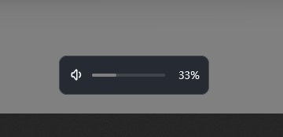

# Bolume

> 一个自己画界面的 Windows 音量混合器：按应用调音量、切设备、调屏幕亮度，带屏幕提示和完整的快捷键体系。

**Rust + [GPUI](https://github.com/zed-industries/zed/tree/main/crates/gpui) 编写 · 单文件 exe · 绿色免安装 · 配置就在 exe 旁边 · 中英双语界面**

目前版本 **0.88** · [下载](../../releases) · [English](#english)

---

## 为什么要再做一个音量工具

Windows 自带的音量合成器能用，但有几件事一直不舒服：

- 想调某个应用，得先点开那个圆形的音量条、再点「打开音量合成器」，两步；
- 每台设备各存一份音量，切换音箱和耳机时要分别再调；
- 快捷键只能调总音量，调不了「当前正在响的那个应用」；
- 屏幕亮度得进系统设置翻；
- 界面是系统画的，改不了。

Bolume 把这些收进屏幕右下角弹出的面板里：一台默认设备 + 正在出声的应用各一行，每行一根滑条一个静音键；快捷键、滚轮、屏幕提示都能挂上去。多屏时面板跟光标走 —— 在哪台屏上点就在哪台屏上弹出。

## 功能

**音量**

- 按应用调音量：百分比 / 跟随对数刻度 / 固定 dB 三种算法，步进可调
- 单应用静音；「调音量时顺手解除静音」可以按动作（音量键 / 应用音量 / 滚轮 / 面板滑条）逐个开关
- 音量上限保护：给某台设备设个天花板，怎么推都不会超过
- 面板里可隐藏不想看到的会话（折叠此应用）；正在发声的应用可置顶
- 应用可以自己起名字：右键 → 重命名，最长 24 字，写进配置，折叠和改名共用同一套键
- 鼠标停在应用图标上 400ms 会浮出完整应用名（名字被省略号截掉、或竖向排版只留图标时用）
- 调音量时响一声：七个内置音色（轻点 / 滴答 / 气泡 / 木鱼 / 棘轮 / 电子 / 铃音）或自己的 WAV，音效音量与生效范围（快捷键 / 滚轮 / 拖拽）分开调

**设备**

- 播放 / 录制设备切换，用的就是系统里那份设备列表
- 设备可改名、可换图标；「系统声音」单独一行
- 启动时自动套用：默认设备、主音量、各应用音量（可配置成每次开机都恢复）

**启动**

- 开机自启两档可选：`用户登录时启动[任务计划程序]` / `普通开机启动`，设置页显示的是系统里的实际状态
- 可以要求启动时以管理员运行：计划任务那档由任务计划程序静默提权，注册表那档会走一次 UAC 确认

**屏幕亮度**

- 走 DDC/CI，直接调显示器硬件亮度，不靠 gamma 蒙
- 当前屏 / 全部屏 / 指定第 N 台三种目标，快捷键可以分开绑
- 亮度面板可以和音量面板融合成一块：横排时铺在音频上方 / 下方，竖排时贴在左侧 / 右侧，排版跟着音量面板走
- 保存的预设整块底部一排（几台屏共用）：点一下套给光标所在那台、按住中键套给全部、拖到某台的亮度条上只套给那台；右键删除前会先确认

**屏幕提示（OSD）**

- 音量、静音、切歌、亮度都能弹一条自己的提示，替掉系统那条
- 替掉的不只是按键：系统那张竖排音量条、按播放/切歌弹出的「正在播放」卡片会被压住不再出现（Win10 / Win11 同一套做法）
- 位置、尺寸、圆角、阴影、动画时长、淡入淡出可调
- 音量、媒体键、亮度三张卡片各有自己的背景（尺寸、圆角、不透明度、背景色各存一套）
- 卡片里的元素（图标、标题、数值、滑条）能单独摆位置、改配色、调图层、转角度 —— 内置布局编辑器，支持撤销
- 转角度三处入口：选中元素后在框的四角外拖圆柄、右侧参数栏里拖滑条 / 点 ±、双击数值直接键入；按住 Shift 吸附到 90° 的整数倍
- 卡片背景本身也能转（画布上边那个圆柄，或「背景卡片 → 角度」），阴影和窗口尺寸都跟着转后的包围盒走
- 文字支持变量（设备名、应用名、音量数值等）

**快捷键**

- 音量 / 应用音量 / 亮度 / 打开面板 / 打开设置 / 媒体键，每组可绑三个组合
- 媒体键与音量键由低级键盘钩子接管，可以自己弹提示、自己转发
- 按住连续触发：每个键自己勾选要不要连发，连发前的延迟（0–9999ms，类似系统的键盘重复延迟）与间隔都可调，可忽略系统长按重复
- NumLock 关着也能识别小键盘数字
- 应用黑名单 + 全屏自动让路：玩游戏时按音量键不会被弹窗打扰

**外观**

- 深色 / 浅色两套打底，默认跟随系统切换；固定模式用深色底
- 背景色与强调色分开自选，亮色档、深色档各存一套；强调色默认跟随 Windows（读 `DWM\AccentColor`）
- 界面字体、字号缩放、字重、对比度、不透明度都能调
- 面板里音量条（含亮度条）的粗细、圆角可调，圆角按条高百分比算，100% 是全圆头
- 弹出动画二选一：`跟随系统`（照系统的指数曲线，从屏幕最底边、任务栏背后滑进来，速度按同一比例缩放）/ `淡入淡出`（原地淡入）；都按屏幕刷新率逐帧推进，**怎么出就怎么回**，收起也能选带不带动画
- 动画可以**打断**：没出完再按一次就从当前位置掉头收回，收回一半再按也能接着弹回来
- 屏幕提示的动画二选一：`淡入淡出` / `跟随系统`（滑上来 + 淡入，消失时滑回去）
- 托盘图标：喇叭弧线跟随音量、或直接显示数字；单色样式可固定颜色，也可让色温随响度走；还能换成自己的 ico

**设置**

- 改动先留在窗口里：底部「应用」写进配置但不关窗，「保存」写进配置并关窗；直接点关闭会问保存 / 不保存 / 取消
- 标题栏右上角的三横杠是恢复：`恢复本页更改` / `恢复全部更改`（退回上一次生效的样子）、`本页恢复出厂设置` / `全部恢复出厂设置`；恢复完同样要点「应用」才落盘，点错了可以再恢复回来
- 同一份三横杠菜单里还能 `只替换本页配置…`：挑一份备份的 `config.json`，只把这**一页**负责的那几个字段搬进当前草稿，其它页不动

**配置档**

- `配置` 页里主配置和副配置是平级的一份份设置，只是主配置那份在根目录叫 `config.json`，其余放在 `Configs/` 里（每个 `.json` 一份）
- 新建的一份从出厂设置开始；新建 / 副本 / 改名 / 导出 / 导入都在这一页，`.json` 文件直接拖到这一页上也会导入
- 「启用」临时切过去、立刻生效，主配置那行的「启用」随时切回来；列表里用「正在使用」标出当前生效的是哪一份
- 启用期间在设置页改的东西，保存时也写回那份档（`config.json` 只是它的影子），所以下次再启用还是改过的样子
- 「设为主配置」把那份**提升**成主配置：内容写进 `config.json`、它的 `.json` 从 `Configs/` 里消失，原来的主配置不再保留（会先弹一句红字警告；想留着就先「副本」）

## 截图

面板（右下角弹出）与亮度面板：


设置 · 外观页（主题、强调色、字体）：


屏幕提示（音量、静音、切歌、亮度各弹一条，位置与样式都能改）：



## 关于

设置页「关于」里写着版本、配置文件位置和项目地址（`https://github.com/wusumu/Bolume`），点「打开」直接跳浏览器；问题反馈走同一个仓库的 Issues。

## 下载

去 [Releases](../../releases) 下最新的 `Bolume_vX.XX.zip`，解压到任意目录，双击 `Bolume.exe`。

- 绿色软件，不写注册表、不装服务；卸载就是删掉文件夹
- 首次运行会在 exe 旁边生成 `config.json`，所有设置都在里面
- 想要开机自启：设置 → 常规 → 开机自动启动

**系统要求**：Windows 10 / 11（64 位）。不需要 .NET、不需要运行库。

## 从源码构建

需要三样东西：

1. **Rust**（rustup 装的 stable 就行，仓库里 `rust-toolchain.toml` 固定了 1.96.0，rustup 会自动装）
2. **Visual Studio Build Tools**，勾选「使用 C++ 的桌面开发」（提供 MSVC 链接器）
3. **Windows SDK**（提供 `rc.exe`，只用来把图标和版本信息编进 exe；没有也能编，只是 exe 没图标）

```bash
git clone <这个仓库的地址>
cd Bolume
cargo build --release
# 产物：target/release/Bolume.exe
```

音频层和界面层是分开的，只想验证音频能不能跑：

```bash
cargo build --release --no-default-features
```

国内网络拉 crates 慢的话，在仓库根目录建 `.cargo/config.toml`（这个文件已加进 `.gitignore`，不会提交）：

```toml
[source.crates-io]
replace-with = "rsproxy-sparse"

[source.rsproxy-sparse]
registry = "sparse+https://rsproxy.cn/index/"
```

跑测试：

```bash
cargo test --release
```

## 命令行参数

平时用不到，调界面 / 排查问题时有用：

| 参数                | 作用                        |
| ----------------- | ------------------------- |
| `--show`          | 启动后立刻把面板弹出来（再执行一次收起）      |
| `--settings`      | 直接打开设置窗                   |
| `--osd-editor`    | 打开屏幕提示的布局编辑器              |
| `--probe`         | 打印播放设备与应用会话（不开窗）          |
| `--probe-display` | 打印显示器与 DDC 亮度读数（不开窗）      |
| `--probe-theme`   | 打印跟随系统时的亮暗 / 强调色解析结果（不开窗） |

## 配置

`config.json` 就在 exe 旁边，纯文本，改完重启生效；删掉就恢复默认。

- `config_rev` 是配置格式版本，程序升级时会自动迁移旧配置
- 设备名、应用音量上限、黑名单等都记在里面，换机器直接拷这个文件
- `Configs/` 里放的是副配置（设置页 `配置` 那一页）：每份一个 `.json`，格式和 `config.json` 一模一样，里面缺的字段按默认补齐；点「启用」就是把它整份装进 `config.json`，所以切换完直接生效
- `config.backup.json` 是「上一次的主配置」快照：启用副配置之前自动存一份（当前用的本来就是某份副配置时不覆盖），主配置那行的「启用」读的就是它，所以切走之后还能切回来。它跟 `config.json` 一起放在程序目录，**不进 `Configs/`** —— 那个文件夹里只有你自己建的档
- 「设为主配置」之后这份副配置的 `.json` 会被删掉（内容已经在 `config.json` 里），快照也一起清掉

## 目录结构

```
src/
  audio/      音频引擎（WASAPI 会话枚举、音量 / 静音命令、设备监听）
  display/    显示器与 DDC/CI 亮度
  platform/   平台层：键盘钩子、托盘、开机自启、系统主题、声音、单实例……
  windows/    窗口：面板(flyout)、设置、屏幕提示(OSD)、布局编辑器、托盘菜单
  ui/         自绘控件（滑条、开关、色块、字体选择……）
  config.rs   配置结构与版本迁移
  gui.rs      gpui 应用装配、快捷键派发
vendor/
  gpui_ce_windows/   打过补丁的 GPUI Windows 平台层（见 Cargo.toml 里的 [patch]）
```

## 已知限制

- 只支持 64 位 Windows
- 亮度走 DDC/CI：笔记本内屏、部分转接线和关了 DDC 的显示器读不到，那台屏的亮度快捷键会静默跳过；开着 HDR 的屏同理（系统的色调映射会吃掉背光变化），显示器和面板里都会标出来、不给调。系统里开关 HDR 不用重启也不用重开面板，两秒内自己跟上
- 「按应用调音量」只对通过音频会话出声的应用有效（有些游戏用独占模式就抓不到）
- 界面完全自绘，不跟随系统高对比度模式

## 致谢

- [GPUI](https://github.com/zed-industries/zed) 与 [gpui-ce](https://crates.io/crates/gpui-ce)：这套自绘界面能跑起来全靠它
- [EarTrumpet](https://github.com/File-New-Project/EarTrumpet)：交互与快捷键管理的最初参考
- `windows-rs`、`tray-icon`、`ddc` 等 crate 的作者们

## 许可证

[MIT](LICENSE)

---

## English

**Bolume** is a from-scratch replacement for the Windows volume mixer, written in Rust with a fully custom-drawn UI (GPUI).

- Per-app volume (percentage / logarithmic / fixed dB), per-app mute, volume caps
- Optional click sound on every volume step: seven built-in tones or your own WAV, with its own volume and per-gesture switches (hotkeys / wheel / drag)
- Switch playback & recording devices, rename them, restore a saved device state at startup
- Monitor brightness over DDC/CI (current / all / a specific display), optionally merged into the volume panel itself — above/below when it is horizontal, left/right when vertical
- Saved brightness presets in one row at the bottom of the block: click to apply to the display under the cursor, middle-click to apply to all, drag onto another display's slider for just that one, right-click to delete after a confirm
- On multi-monitor setups the panel pops up on the display where the cursor is, not always on the primary
- Its own on-screen display for volume, mute, track changes and brightness, with a layout editor; the volume card and the media-key card can each have their own background (size, corners, opacity, color)
- Global hotkeys for everything, including media keys taken over through a low-level keyboard hook, hold-to-repeat, and an app blocklist that gets out of the way in fullscreen games
- Light/dark themes, follow Windows accent color, adjustable UI font & scale, bilingual UI (中文 / English)
- Edits stay in the window until you press **Apply** (save, keep editing) or **Save** (save and close); closing with pending edits asks save / don't save / cancel. The ≡ menu in the title bar reverts this page or everything, or restores factory defaults, per page or wholesale
- The same ≡ menu can `Replace this page only…`: pick a backed-up `config.json` and only the fields that page owns are copied into the current draft, nothing else moves
- Profiles: the **Profiles** page keeps several full setups — every `.json` in `Configs/` next to the exe is one of them, while the main config stays `config.json`. A new profile starts from the factory defaults; create / copy / rename / export / import there, or just drop a `.json` onto the page. **Use** switches to a profile temporarily and the main config row's **Use** switches back (the list marks the active one); anything you save while it is in use goes back into that profile as well, so it keeps your edits; **Make main** promotes that profile — its content becomes `config.json`, its `.json` leaves the `Configs` list, and the old main config is gone (a red warning comes first)
- Popup animations can follow the system: the panel and the OSD both rise from the bottom edge of the screen from *behind* the taskbar, animated frame-by-frame in sync with the display refresh rate, matching how Windows 11 (and 10) animate their own volume surfaces

Download the latest `Bolume_vX.XX.zip` from [Releases](../../releases), extract anywhere and run `Bolume.exe`. Windows 10/11 x64, no installer, no .NET.

Build from source: install Rust + VS Build Tools + Windows SDK, then `cargo build --release`.

Licensed under the [MIT License](LICENSE).
