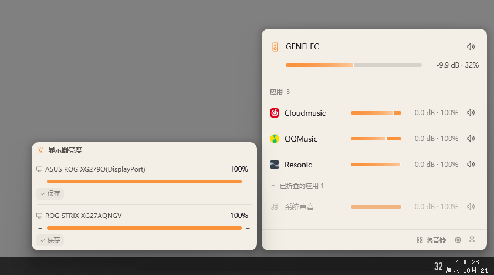
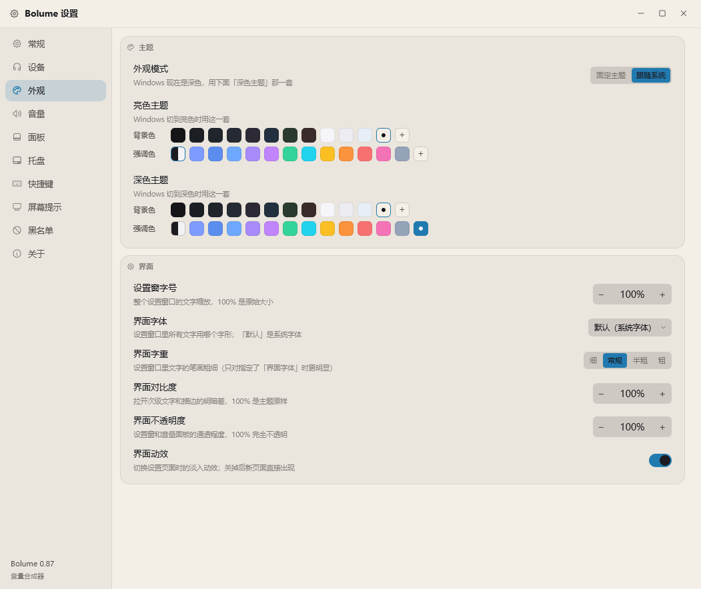

# Bolume

> 一个自己画界面的 Windows 音量混合器：按应用调音量、切设备、调屏幕亮度，带屏幕提示和完整的快捷键体系。

**Rust + [GPUI](https://github.com/zed-industries/zed/tree/main/crates/gpui) 编写 · 单文件 exe · 绿色免安装 · 配置就在 exe 旁边 · 中英双语界面**

目前版本 **0.83** · [下载](../../releases) · [English](#english)

---

## 为什么要再做一个音量工具

Windows 自带的音量合成器能用，但有几件事一直不舒服：

- 想调某个应用，得先点开那个圆形的音量条、再点「打开音量合成器」，两步；
- 每台设备各存一份音量，切换音箱和耳机时要分别再调；
- 快捷键只能调总音量，调不了「当前正在响的那个应用」；
- 屏幕亮度得进系统设置翻；
- 界面是系统画的，改不了。

Bolume 把这些收进一个右下角弹出的面板里：一台默认设备 + 正在出声的应用各一行，每行一根滑条一个静音键；快捷键、滚轮、屏幕提示都能挂上去。

## 功能

**音量**

- 按应用调音量：百分比 / 跟随对数刻度 / 固定 dB 三种算法，步进可调
- 单应用静音；「调音量时顺手解除静音」可以按动作（音量键 / 应用音量 / 滚轮 / 面板滑条）逐个开关
- 音量上限保护：给某台设备设个天花板，怎么推都不会超过
- 面板里可隐藏不想看到的会话（折叠此应用）；正在发声的应用可置顶
- 应用可以自己起名字：右键 → 重命名，最长 24 字，写进配置，折叠和改名共用同一套键
- 鼠标停在应用图标上 400ms 会浮出完整应用名（名字被省略号截掉、或竖向排版只留图标时用）

**设备**

- 播放 / 录制设备切换，用的就是系统里那份设备列表
- 设备可改名、可换图标；「系统声音」单独一行
- 启动时自动套用：默认设备、主音量、各应用音量（可配置成每次开机都恢复）

**启动**

- 开机自启三档可选：`系统启动时启动` / `用户登录时启动` / `普通开机启动`，设置页显示的是系统里的实际状态
- 可以要求启动时以管理员运行：任务那两档由任务计划程序静默提权，注册表那档会走一次 UAC 确认

**屏幕亮度**

- 走 DDC/CI，直接调显示器硬件亮度，不靠 gamma 蒙
- 当前屏 / 全部屏 / 指定第 N 台三种目标，快捷键可以分开绑

**屏幕提示（OSD）**

- 音量、静音、切歌、亮度都能弹一条自己的提示，替掉系统那条
- 位置、尺寸、圆角、阴影、动画时长、淡入淡出可调
- 卡片里的元素（图标、标题、数值、滑条）能单独摆位置、改配色、调图层 —— 内置布局编辑器，支持撤销
- 文字支持变量（设备名、应用名、音量数值等）

**快捷键**

- 音量 / 应用音量 / 亮度 / 打开面板 / 打开设置 / 媒体键，每组可绑三个组合
- 媒体键与音量键由低级键盘钩子接管，可以自己弹提示、自己转发
- 按住连续触发（间隔可调、可忽略系统长按重复）
- NumLock 关着也能识别小键盘数字
- 应用黑名单 + 全屏自动让路：玩游戏时按音量键不会被弹窗打扰

**外观**

- 深色 / 浅色两套打底，默认跟随系统切换；固定模式用深色底
- 背景色与强调色分开自选，亮色档、深色档各存一套；强调色默认跟随 Windows（读 `DWM\AccentColor`）
- 界面字体、字号缩放、字重、对比度、不透明度都能调
- 面板里音量条（含亮度条）的粗细、圆角可调，圆角按条高百分比算，100% 是全圆头
- 弹出动画二选一：`跟随系统`（照系统的指数曲线，从屏幕最底边、任务栏背后滑进来，速度按同一比例缩放）/ `淡入淡出`（原地淡入）；都按屏幕刷新率逐帧推进，**怎么出就怎么回**，收起也能选带不带动画
- 动画可以**打断**：没出完再按一次就从当前位置掉头收回，收回一半再按也能接着弹回来
- 屏幕提示的动画二选一：`淡入淡出` / `跟随系统`（滑上来 + 淡入，消失时滑回去）
- 托盘图标：喇叭弧线跟随音量、或直接显示数字；波形动画可调增益

## 截图

面板（右下角弹出）与亮度面板：



设置 · 外观页（主题、强调色、字体）：



## 关于

设置页「关于」里写着版本、配置文件位置和项目地址（`https://github.com/wusumu/Bolume`），点「打开」直接跳浏览器；问题反馈走同一个仓库的 Issues。

## 下载

去 [Releases](../../releases) 下最新的 `Bolume_vX.XX.zip`，解压到任意目录，双击 `Bolume.exe`。

- 绿色软件，不写注册表、不装服务；卸载就是删掉文件夹
- 首次运行会在 exe 旁边生成 `config.json`，所有设置都在里面
- 想要开机自启：设置 → 常规 → 开机自动启动

**系统要求**：Windows 10 / 11（64 位）。不需要 .NET、不需要运行库。

## 从源码构建

需要三样东西：

1. **Rust**（rustup 装的 stable 就行，仓库里 `rust-toolchain.toml` 固定了 1.96.0，rustup 会自动装）
2. **Visual Studio Build Tools**，勾选「使用 C++ 的桌面开发」（提供 MSVC 链接器）
3. **Windows SDK**（提供 `rc.exe`，只用来把图标和版本信息编进 exe；没有也能编，只是 exe 没图标）

```bash
git clone <这个仓库的地址>
cd Bolume
cargo build --release
# 产物：target/release/Bolume.exe
```

音频层和界面层是分开的，只想验证音频能不能跑：

```bash
cargo build --release --no-default-features
```

国内网络拉 crates 慢的话，在仓库根目录建 `.cargo/config.toml`（这个文件已加进 `.gitignore`，不会提交）：

```toml
[source.crates-io]
replace-with = "rsproxy-sparse"

[source.rsproxy-sparse]
registry = "sparse+https://rsproxy.cn/index/"
```

跑测试：

```bash
cargo test --release
```

## 命令行参数

平时用不到，调界面 / 排查问题时有用：

| 参数                | 作用                        |
| ----------------- | ------------------------- |
| `--show`          | 启动后立刻把面板弹出来（再执行一次收起）      |
| `--settings`      | 直接打开设置窗                   |
| `--osd-editor`    | 打开屏幕提示的布局编辑器              |
| `--probe`         | 打印播放设备与应用会话（不开窗）          |
| `--probe-display` | 打印显示器与 DDC 亮度读数（不开窗）      |
| `--probe-theme`   | 打印跟随系统时的亮暗 / 强调色解析结果（不开窗） |

## 配置

`config.json` 就在 exe 旁边，纯文本，改完重启生效；删掉就恢复默认。

- `config_rev` 是配置格式版本，程序升级时会自动迁移旧配置
- 设备名、应用音量上限、黑名单等都记在里面，换机器直接拷这个文件

## 目录结构

```
src/
  audio/      音频引擎（WASAPI 会话枚举、音量 / 静音命令、设备监听）
  display/    显示器与 DDC/CI 亮度
  platform/   平台层：键盘钩子、托盘、开机自启、系统主题、声音、单实例……
  windows/    窗口：面板(flyout)、设置、屏幕提示(OSD)、布局编辑器、托盘菜单
  ui/         自绘控件（滑条、开关、色块、字体选择……）
  config.rs   配置结构与版本迁移
  gui.rs      gpui 应用装配、快捷键派发
vendor/
  gpui_ce_windows/   打过补丁的 GPUI Windows 平台层（见 Cargo.toml 里的 [patch]）
```

## 已知限制

- 只支持 64 位 Windows
- 亮度走 DDC/CI：笔记本内屏、部分转接线和关了 DDC 的显示器读不到，那台屏的亮度快捷键会静默跳过
- 「按应用调音量」只对通过音频会话出声的应用有效（有些游戏用独占模式就抓不到）
- 界面完全自绘，不跟随系统高对比度模式

## 致谢

- [GPUI](https://github.com/zed-industries/zed) 与 [gpui-ce](https://crates.io/crates/gpui-ce)：这套自绘界面能跑起来全靠它
- [EarTrumpet](https://github.com/File-New-Project/EarTrumpet)：交互与快捷键管理的最初参考
- `windows-rs`、`tray-icon`、`ddc` 等 crate 的作者们

## 许可证

[MIT](LICENSE)

---

## English

**Bolume** is a from-scratch replacement for the Windows volume mixer, written in Rust with a fully custom-drawn UI (GPUI).

- Per-app volume (percentage / logarithmic / fixed dB), per-app mute, volume caps
- Switch playback & recording devices, rename them, restore a saved device state at startup
- Monitor brightness over DDC/CI (current / all / a specific display)
- Its own on-screen display for volume, mute, track changes and brightness, with a layout editor
- Global hotkeys for everything, including media keys taken over through a low-level keyboard hook, hold-to-repeat, and an app blocklist that gets out of the way in fullscreen games
- Light/dark themes, follow Windows accent color, adjustable UI font & scale, bilingual UI (中文 / English)
- Popup animations can follow the system: the panel and the OSD both rise from the bottom edge of the screen from *behind* the taskbar, animated frame-by-frame in sync with the display refresh rate, matching how Windows 11 (and 10) animate their own volume surfaces

Download the latest `Bolume_vX.XX.zip` from [Releases](../../releases), extract anywhere and run `Bolume.exe`. Windows 10/11 x64, no installer, no .NET.

Build from source: install Rust + VS Build Tools + Windows SDK, then `cargo build --release`.

Licensed under the [MIT License](LICENSE).
